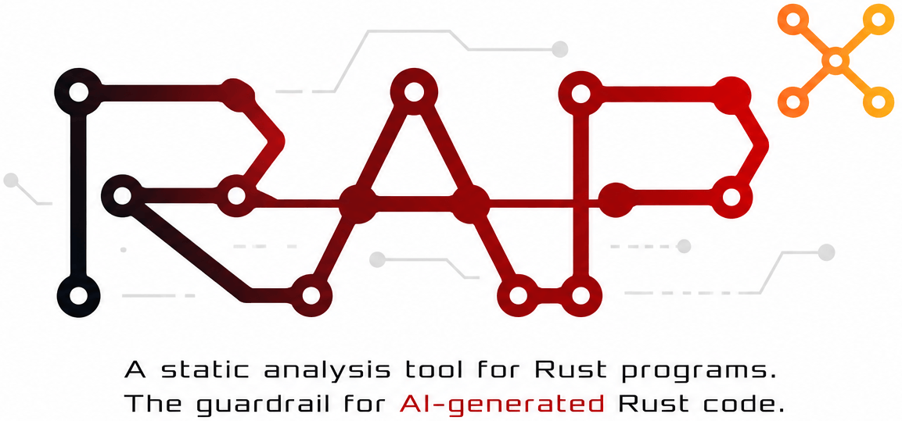

# 
RAPx (Rust Analysis Platform with Extensions) [](./LICENSE-MPL)[](https://docs.rs/rapx) is an advanced static analysis platform for Rust. It provides an extensible framework for building and integrating powerful analysis capabilities that go beyond those available in the standard rustc compiler, empowering developers to reason about safety, robustness, and performance at a deeper level.

RAPx is available on crates.io. [](https://crates.io/crates/rapx)

## Features
# 
RAPx is structured into two layers: a core layer offering essential program analysis algorithms (e.g., alias and dataflow analysis), and an application layer implementing specific tasks such as bug detection. This separation of concerns promotes modular development and fosters collaboration between algorithm and application developers.

The project is still under heavy development. For further details, please refer to the [RAPx-Book](https://safer-rust.github.io/RAPx-Book/).

## Quick Start

Install the latest `nightly` toolchain, on which rapx is compiled. This just needs to be done once on your machine. If the toolchain exists,
this will do nothing.

```shell
rustup toolchain install nightly --profile minimal --component rustc-dev,rust-src,llvm-tools-preview
cargo +nightly install rapx --git https://github.com/safer-rust/RAPx.git
```

## Usage

Navigate to your Rust project folder containing a `Cargo.toml` file. Then run `rapx` by manually specifying the toolchain version according to the [toolchain override shorthand syntax](https://rust-lang.github.io/rustup/overrides.html#toolchain-override-shorthand).

```shell
cargo +nightly rapx [rapx options] -- [cargo check options]
```

or by setting up default toolchain to the required version.
```shell
rustup default nightly
```

Everything after `--` is forwarded verbatim to `cargo check`, so `--target` and other
cargo flags work for cross-compiled or bare-metal (`#![no_std]`) crates:

```shell
# verify a no_std kernel crate for a bare-metal target
cargo rapx verify --crate ostd -- --target x86_64-unknown-none
```

Here `ostd` is the kernel crate from [asterinas/asterinas](https://github.com/asterinas/asterinas/tree/main/ostd).

Make sure the target is installed first (`rustup target add x86_64-unknown-none`).

Run `cargo rapx --help` for the command list and `cargo rapx <command> --help` for its options.

### `analyze` command

```
Usage: cargo rapx analyze <COMMAND>

Commands:
  alias       alias analysis (meet-over-paths by default)
  adg         API dependency graphs
  callgraph   callgraph generation
  dataflow    dataflow graphs
  heapowner   analyze heap-owning types
  paths       path-sensitive CFG paths
  range       range analysis
  scan        basic crate info
  mir         print MIR
  dot-mir     print MIR as DOT
  help        Print this message or the help of the given subcommand(s)

Options:
  -h, --help  Print help
```

### `check` command

```
Usage: cargo rapx check [OPTIONS]

Options:
  -f, --uaf [<UAF>]    detect use-after-free/double-free (optional level, default 1)
  -m, --mleak          detect memory leakage
  -h, --help           Print help
```

### `opt` command

```
Usage: cargo rapx opt
```

### `verify` command

The `verify` command checks contract obligations using path-sensitive analysis, structural rules, and Z3. By default it scans functions with unsafe calls or struct invariants; `--mode targeted` selects functions annotated with `#[rapx::verify]`.

```
Usage: cargo rapx verify [OPTIONS]

Options:
      --prepare-targets           list targets and resolved contracts without verification
      --postfix-repeat <N|auto>   extra SCC repetitions; auto estimates per target (default: auto)
      --mode <MODE>               scan or targeted (default: scan)
      --crate <CRATE>             filter targets by Rust crate or Cargo package name
      --module <MODULE_PATH>      filter targets by module path
      --path-limit <N>            cap paths collected per checkpoint (0 selects the built-in default)
      --trait-impl-limit <N>      cap virtual-call impls and generic combinations (default: 1)
      --debug-contracts          print expanded contracts without verification
  -h, --help                     Print help
```

Lowering `--path-limit` can speed up verification; omitted paths are currently treated as proved in the verdict.

**Filtering targets:** `--crate` and `--module` work in any mode and can be combined. When analyzing standard-library workspaces or sub-workspaces:

```bash
# Verify a specific module (single crate or workspace)
cargo rapx verify --module my_mod::sub

# Verify a specific crate in a workspace
cargo rapx verify --crate my_crate

# Combine both for precise targeting (e.g. standard library)
cargo rapx verify --crate core --module ptr::NonNull
cargo rapx verify --crate std --module collections::vec
```

When `--module` is used without `--crate`, a `crate_name::module` prefix is also accepted for backward compatibility (e.g. `--module core::ptr` strips the `core::` prefix automatically).

```rust
#![feature(register_tool)]
#![register_tool(rapx)]

#[rapx::verify]
fn init_buffer(buf: *mut u32, len: usize) {
    unsafe {
        // rapx checks: NonNull(buf), Align(buf, u32), InBound(buf, len)
        core::ptr::write(buf.add(len - 1), 0);
    }
}

#[rapx::requires(NonNull(_ptr))]
unsafe fn custom_ptr_op(_ptr: *const i32) -> i32 {
    unsafe { *_ptr }
}
```

Struct fields holding raw pointers can carry `#[rapx::invariant(...)]` annotations. Methods assume the invariants on entry (constructors re-establish them at return), which lets RAPx verify patterns like linked-list `Drop` implementations where the pointer's provenance lives in the type's invariant rather than in the function body:

```rust
// Fields that may be null use the `any(...)` combinator (logical OR;
// commas inside a parenthesised group mean logical AND): every property
// holds whenever the pointer is non-null and vacuously when it is null.
#[rapx::invariant(any(Null(next), (Align(next, Node), ValidPtr(next, Node, 1), Allocated(next, Node, 1), Typed(next, Node), Owning(next))))]
struct Node {
    value: i32,
    prev: *mut Node,
    next: *mut Node,
}

// Option<NonNull<T>> fields express the same conditionality with
// `unwrap_some()`: the property constrains the Some payload only.
#[rapx::invariant(Align(head.unwrap_some(), Node))]
#[rapx::invariant(Allocated(head.unwrap_some(), Node, 1))]
#[rapx::invariant(Typed(head.unwrap_some(), Node))]
#[rapx::invariant(Owning(head.unwrap_some()))]
struct List {
    head: Option<core::ptr::NonNull<Node>>,
}
```

See `rapx/tests/verify_cases/linked_list_rawptr` and `rapx/tests/verify_cases/linked_list_nonnull` for complete examples proved SOUND end-to-end (including `Box::from_raw` in `Drop`).

Safety properties include: `Align`, `NonNull`, `Allocated`, `InBound`, `Init`, `ValidPtr`, `Deref`, `Ptr2Ref`, and more. See the [RAPx-Book](https://safer-rust.github.io/RAPx-Book/) for the full list.

### Verification Property Support Checklist

This checklist maps RAPx's contract verification to the [Primitive Safety Properties](https://github.com/safer-rust/safety-tags/blob/main/primitive-sp.md) defined in `safer-rust/safety-tags`.

> **Legend**: ✅ = implemented checker using structural rules and/or SMT (individual checks may still be `UNKNOWN`); — = unsupported checker, reported as `UNKNOWN`; assumption = treated as satisfied without a corresponding VM model.

| safety-tag     | Example                     | Status |
|----------------|-----------------------------|:---------:|
| `Align`        | Align(p, T)                 |     ✅    |
| `Size`         | Size(T, c)                  |     ✅    |
| `NoPadding`    | !Padding(T)                 |     ✅    |
| `NonNull`      | !Null(p)                    |     ✅    |
| `Allocated`    | Allocated(p, T, len, A)     |     ✅    |
| `InBound`      | InBound(p, T, len)          |     ✅    |
| `NonOverlap`   | !Overlap(dst, src, T, len)  |     ✅    |
| `ValidNum`     | ValidNum(exp, vrange)       |     ✅    |
| `ValidString`  | ValidString(arange)         |     ✅    |
| `ValidCStr`    | ValidCStr(p, len)           |     ✅    |
| `Init`         | Init(p, T, len)             |     ✅    |
| `Unwrap`       | Unwrap(x, T)                |     —     |
| `Typed`        | Typed(p, T)                 |     ✅    |
| `ValidTransmute` \*† | ValidTransmute(T, U)   |     ✅    |
| `SplitTransmute` \*†  | SplitTransmute(T, U)   |     ✅    |
| `Owning`       | Owning(p)                   |     ✅    |
| `Alias`        | Alias(p1, p2)               |     ✅    |
| `Alive`        | Alive(p, l)                 |     ✅    |
| `Pinned`       | Pinned(p, l)                |     —     |
| `NonVolatile`  | !Volatile(p, T, len)        | assumption |
| `Opened`       | Opened(fd)                  |     —     |
| `Trait`        | Trait(T, trait)             |     ✅    |
| `Unreachable`  | !Reachable()                |     —     |
| `ValidPtr` \*  | ValidPtr(p, T, len)         |     ✅    |
| `Deref` \*     | Deref(p, T, len)            |     ✅    |
| `Ptr2Ref` \*   | Ptr2Ref(p, T)               |     ✅    |
| `Layout` \*    | Layout(p, layout)           |     ✅    |

> \* Compound safety properties are composed from primitive SPs: `Deref(p, T, len) = Allocated(p, T, len) && InBound(p, T, len)`, `ValidPtr(p, T, len) = NonNull(p) && (Size(T, 0) || Deref(p, T, len))`, `Ptr2Ref(p, T) = Init(p, T, 1) && ValidPtr(p, T, 1) && Align(p, T) && Alias(p)`, and `Layout(p, l) = ValidNum(p % l.align == 0) && Allocated(p, u8, l.size, Global)`.
>
> \*† `ValidTransmute` and `SplitTransmute` are specializations of `Typed` for transmute operations: `ValidTransmute(T, U)` checks that a `T`-typed value is a valid bit-pattern of `U`, while `SplitTransmute` checks that every `size_of(U)`-byte contiguous chunk of a `T`-typed value is a valid `U` bit-pattern.

RAPx ships with [standard-library API contracts](rapx/src/contract/assets/std-api-requires.json) that annotate `std` and `core` functions with property tags. These contracts support verification without requiring user annotations.

Beyond the built-in tags, users can define their own named contracts inside their crate with the `pred!` macro (from `rapx_macros`) — a boolean combination of the primitive safety properties — and reference them from `#[rapx::requires(MyTag(...))]` without rebuilding `rapx`:

```rust
use rapx_macros::pred;

// Name(params) { body } — params carry a role: Ptr | Ty | Expr | Ident.
pred!(Readable(p: Ptr, T: Ty, n: Expr) { NonNull(p) && Align(p, T) && Allocated(p, T, n) && Init(p, T, n) });

#[rapx::requires(Readable(ptr, u8, len))]
unsafe fn read_byte(ptr: *const u8, len: usize) -> u8 { unsafe { *ptr } }
```

The verifier is exercised against safe abstractions built on unsafe code — for example `core::slice`-style methods such as `split_at`, `as_chunks`/`as_rchunks`, `as_flattened`, `binary_search`, `partition_dedup`, and `get_disjoint_mut`. RAPx reports `SOUND` when it discharges the collected obligations, `UNSOUND` when it finds a possible violation, and `UNKNOWN` when it cannot complete a proof. Each SMT query has a timeout, so unresolved goals can return `UNKNOWN`.

### Environment Variables (values are case insensitive)

| var             | default when absent | possible values     | description                  |
|-----------------|---------------------|---------------------|------------------------------|
| `RAPX_LOG`       | info                | trace, debug, info, warn | verbosity of logging   |
| `RAPX_CLEAN`     | true                | true, false         | run cargo clean before check |
| `RAPX_RECURSIVE` | none                | none, shallow, deep | scope of packages to check   |
| `RAPXFLAGS`      | (unset)             | CLI arguments       | arguments passed to `rapx` binary directly |

For `RAPX_RECURSIVE`:
* `none`: check for current folder
* `shallow`: check for current workspace members
* `deep`: check for all workspaces from current folder

NOTE: for `shallow` or `deep`, rapx will enter each member folder to do the check.

If RAPx gets stuck after executing `cargo clean`, try manually downloading metadata dependencies by running `cargo metadata`.

