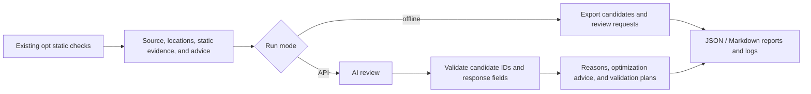

# opt: static analysis, AI review, and reports

This feature adds an AI review layer to opt, based on commit `2acce3a` of
`agent-dev`. It preserves all six existing opt rule categories and the
implementations of verify, rcanary, safedrop, scan, and mir. Changes to
`cli.rs`, `lib.rs`, and cargo-rapx connect the new command.



## Installation and usage

Use RAPx's existing Rust nightly, rustc-dev, rust-src, LLVM, and Z3 build
requirements. The review layer also requires Python 3.10+ and uses only its
standard library, with no additional Python packages or Cargo dependencies.
Build from the repository root:

```bash
cargo build -p rapx --bins
export PATH="$PWD/target/debug:$PATH"
# On Linux, load rustc_driver from the same toolchain when running binaries or tests.
export LD_LIBRARY_PATH="$(rustc --print sysroot)/lib${LD_LIBRARY_PATH:+:$LD_LIBRARY_PATH}"
# Alternatively: cargo install --path rapx
# The Python helper is embedded in the binary; the source checkout is not required.
```

Run these commands in the crate you want to analyze:

```bash
cargo rapx opt-ai --offline
cargo rapx optAI --offline --output ./review-output -- --lib
cargo rapx --timeout 120 opt-ai --offline -- --features optimized
```

Arguments after `--` are forwarded to `cargo check`, including package,
workspace, features, and manifest-path selectors. The command manages
`--target-dir` itself and uses a separate build directory for each run to
ensure analysis actually executes. Existing build caches are preserved, but
large projects will rebuild dependencies on the first run. `--timeout` limits
the static scan. On POSIX, timeout handling terminates the process group;
on Windows, it only guarantees termination of the direct child process.

Online review requires an explicitly configured provider and model:

```bash
export RAPX_AI_URL='https://your-provider.example/v1/chat/completions'
export RAPX_AI_MODEL='your-model-id'
# Set RAPX_AI_API_KEY securely in the local environment.
# Keep real keys out of source files, screenshots, and reports.
cargo rapx opt-ai --api-timeout 60 --max-findings 20 --max-context-bytes 48000
```

Use `--api-url` and `--model` to override the environment variables. The API key
is read only from `RAPX_AI_API_KEY`; `RAPX_PYTHON` selects the interpreter.
The provider must support Chat Completions `messages`,
`response_format: {type: json_object}`, and `choices[0].message.content`.
The compatible protocol lets the team choose its provider without a default
model binding. Protocol reference:
[Create chat completion](https://developers.openai.com/api/reference/resources/chat/subresources/completions/methods/create).
JSON mode does not guarantee correct application fields, so the implementation
also validates the candidate ID, verdict enum, and every required field.

Online requests contain the reported function or loop source snippet, file
locations, static annotations, and advice. The command does not collect the
entire repository automatically. Advice from the static warning is treated as
evidence for review. Remote endpoints require HTTPS; loopback services may use
HTTP. Requests do not follow HTTP redirects. The tool does not log the key or
pass its key to compiler subprocesses. Failed requests retain their candidates
and are not retried automatically.

## Output and status

The command prints the newly created `run-*` directory. Each run stores its own
results and does not read results from previous runs:

| File | Purpose |
|---|---|
| `static.log` / `invocation.json` | Raw compiler and analysis logs, invocation, and working directory |
| `evidence/*.jsonl` | Separate begin / finding / complete records for each rustc process |
| `candidates.json` | Deduplicated static candidates with crate, source, locations, annotations, advice, and SHA-256 IDs |
| `requests/*.json` | Request templates containing the full prompt and evidence, without the key |
| `report.json` / `report.md` | Per-candidate reviews and summaries that retain the static findings |

The terminal output of `cargo rapx opt` is unchanged. The optional
`RAPX_OPT_EVIDENCE_DIR` variable is an internal structured-output interface;
the directory must already exist. Each process writes a separate file to avoid
interleaving output during parallel workspace analysis. A record represents one
OptReport, which may annotate multiple locations, so the number of records can
differ from the number of sites in static statistics. IDs include source and
location information and change when the code changes. Compare locations and
rule titles when reviewing before/after results.

Review verdicts:

- `keep`: an optimization opportunity worth validating further.
- `dismiss`: the AI suspects a false positive; the original warning is retained.
- `uncertain`: insufficient evidence about semantics or cost.
- `unreviewed`: no accepted AI verdict, for example because of offline mode,
  a budget limit, a network failure, or an invalid response.

A failed scan, missing begin/complete records, invalid JSON, timeout, or missing
key is never reported as "no optimization opportunities." A successful scan with
zero candidates needs no API key. Offline and successful runs exit with code 0;
model request, configuration, and static scan failures exit with code 2.
Reaching a user-selected request or context budget exits with code 0, but the
report has `status=partial` and identifies the unreviewed candidates.
Each request is sent in full or skipped; truncated context is not presented as
a complete review. `api_calls` counts actual request attempts. A valid
`uncertain` verdict counts as a completed review, not a confirmed optimization.

## Scope and limitations

Rust performs the existing opt analysis and exports type/dataflow evidence,
source locations, and serialized reports. The Python standard library handles
process orchestration, HTTP requests, response validation, and reporting.
AI explains findings and proposes validation plans without changing static
verdicts. The command does not rewrite source, execute model-returned commands,
insert unsafe code, or prove performance improvements.

For optimizations explicitly requested by the user, the companion
[`rapx-opt-review` skill](../skills/rapx-opt-review/SKILL.md) guides the assistant
through a scoped edit, relevant tests, and another opt run while retaining the
before/after results. This workflow applies only to opt.

Context is currently limited to a function or loop; it does not include
interprocedural slices. Reviews that require unavailable external context should
be marked `uncertain`. Structured export covers the existing OptReport interface
without improving checker coverage. Measuring model accuracy, false-positive
reduction, or actual performance gains requires a separate labeled dataset and
benchmarks; mock API tests cannot establish those results.

## Validation and demo

```bash
python3 -m unittest discover -s tools/opt -p test_opt_ai.py -v
RAPX_TEST_CARGO_RAPX="$PWD/target/debug/cargo-rapx" \
  python3 -m unittest discover -s tools/opt -p test_opt_ai.py -v
cargo test -p rapx --test tests opt_ -- --test-threads=1
python3 tools/opt/demo_opt_ai.py --cargo-rapx "$PWD/target/debug/cargo-rapx"
```

The first command runs protocol/report unit tests and explicitly skips the real
compiler tests. The second includes real opt analysis and a loopback mock
provider, covering offline mode, zero candidates, missing keys, request limits,
context limits, HTTP errors, incorrect IDs, and key echoes. Mocks validate
integration and control flow, not model quality.

The demo runs offline by default; `--api` enables requests to the configured
provider. It compares two manually prepared implementations and runs correctness
tests and static analysis for both. See the [two-page opt presentation notes](opt-ai-demo.md).

The demo uses the Vec front-removal rule already present in `agent-dev`,
comparing FIFO consumption with `Vec::remove(0)` and `VecDeque::pop_front`
while preserving output order. Static advice and AI opinions are recorded
separately. No additional local experimental rules are included. Performance
gains still require separate measurement.

Validation on 2026-10-28, after the CI fixes: the nightly build, 8 unit tests,
391 integration tests, and 13 Python protocol/compiler/mock API tests passed.
The integration run retained the existing 2 ignored tests and 5 CI exclusions.
All 4 opt regression tests passed. Each demo variant passed 1 Rust test with
345 result assertions, and the Vec front-removal candidate count changed from
1 to 0. All three GitHub CI jobs passed, including the standard-library baseline
of 38 SOUND, 0 UNKNOWN, and 0 UNSOUND. No performance benchmark was run.
