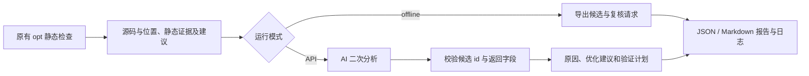

# opt：静态分析 → AI 复核 → 报告

本分支只实现 opt 的 AI 复核层，基于 `agent-dev` 分支的 `2acce3a`。
原有六类 opt 规则保持原样，也没有修改 verify、
rcanary、safedrop、scan 或 mir 的实现。`cli.rs`、`lib.rs` 和 cargo-rapx 的改动
仅用于接入新命令。



## 安装与使用

沿用 RAPx 的 Rust nightly、rustc-dev、rust-src、LLVM 和 Z3 构建要求，增加
Python 3.10+ 标准库运行时，不引入 Python 第三方包或新的 Cargo 依赖。
在仓库根目录构建：

```bash
cargo build -p rapx --bins
export PATH="$PWD/target/debug:$PATH"
# Linux 上直接运行二进制/测试脚本时，加载同一工具链的 rustc_driver
export LD_LIBRARY_PATH="$(rustc --print sysroot)/lib${LD_LIBRARY_PATH:+:$LD_LIBRARY_PATH}"
# 或 cargo install --path rapx；Python helper 已嵌入二进制，无需保留源码目录
```

在需要分析的 crate 目录执行：

```bash
cargo rapx opt-ai --offline
cargo rapx optAI --offline --output ./review-output -- --lib
cargo rapx --timeout 120 opt-ai --offline -- --features optimized
```

`--` 后的参数传给 `cargo check`，支持 package、workspace、features、manifest-path
等原 Cargo 选择条件。`--target-dir` 由本命令管理；每次使用独立构建目录确保分析
实际运行，不删除用户原有编译缓存。大项目首轮会重新构建依赖。`--timeout` 管理
静态扫描超时；POSIX 下会终止整组子进程，Windows 下仅保证终止直接子进程。

在线模式需要显式配置服务和模型：

```bash
export RAPX_AI_URL='https://your-provider.example/v1/chat/completions'
export RAPX_AI_MODEL='your-model-id'
# 在本机安全地设置 RAPX_AI_API_KEY；不要把真实 key 写进源码、截图或报告
cargo rapx opt-ai --api-timeout 60 --max-findings 20 --max-context-bytes 48000
```

也可以用 `--api-url`、`--model` 覆盖环境变量。API key 只从 `RAPX_AI_API_KEY`
读取；解释器可用 `RAPX_PYTHON` 指定。服务须支持 Chat Completions 的 messages、
`response_format: {type: json_object}` 和 `choices[0].message.content`。
本实现选择兼容协议以支持团队自行选择服务，不默认绑定某个模型。
协议依据：[Create chat completion](https://developers.openai.com/api/reference/resources/chat/subresources/completions/methods/create)。
JSON mode 不保证业务字段正确，因此代码还会校验候选 id、枚举和每个必需字段。

在线请求发送的是报告中的函数/循环源码片段、文件位置、静态标注及建议；不会
自动收集全仓库。原始静态告警中的建议也只作为证据。远端 endpoint 要求 HTTPS；
本机服务允许 loopback HTTP。不跟随 HTTP 重定向，不记录 key，不向编译子进程
传入本工具的 key；请求失败保留候选且不自动重试。

## 输出和状态

命令打印新建的 `run-*` 目录。每次运行独立保存，不会读取旧结果：

| 文件 | 用途 |
|---|---|
| `static.log` / `invocation.json` | 原始编译/分析日志、调用命令和工作目录 |
| `evidence/*.jsonl` | 每个 rustc 进程自己的 begin / finding / complete 记录 |
| `candidates.json` | 去重后静态候选，包含 crate、源码、位置、标注、建议和 SHA-256 id |
| `requests/*.json` | 实际请求模板，含完整 prompt 与证据，不含 key |
| `report.json` / `report.md` | 保留静态判断的逐条复核结果及汇总 |

已有 `cargo rapx opt` 的终端输出不变。可选 `RAPX_OPT_EVIDENCE_DIR` 是内部
结构化输出接口，目录必须已存在；每个进程独立写文件，避免 workspace 并行交错。
记录的粒度是一次 OptReport，一个报告可能标注多个位置，不等于静态统计的站点数。
id 包含源码和位置，代码变化后会变化，前后对比应结合位置与规则标题。

复核 verdict：

- `keep`：值得继续验证的优化机会。
- `dismiss`：AI 判断疑似误报，原始告警仍保留。
- `uncertain`：语义或代价证据不足。
- `unreviewed`：离线、超预算、网络失败、返回格式错误等，没有接受 AI 判断。

扫描失败、无开始/完成记录、无效 JSON、超时和缺 key 都不会被写成“无优化空间”。
正常零候选无需 API key。离线与正常结束退出 0；模型请求/配置/静态扫描失败退出 2。
主动设置的请求数/上下文预算用尽时退出 0，但报告 status=partial，并明确哪些未复核。
每条请求完整发送或跳过，不截断上下文后冒充完整复核。`api_calls` 记录实际尝试数。
valid verdict=uncertain 属于完成复核，并不等于确认优化。

## 实现边界

Rust 负责原 opt 分析、类型/数据流证据、源位置以及序列化导出；Python 标准库负责
进程编排、HTTP、返回校验和报告。AI 负责解释和提出验证计划，不修改原静态判定。
本命令不自动改源码，不执行模型返回的命令，不自动插入 unsafe，也不声称完成了
优化收益证明。对于用户明确要求实施的优化，由配套
[`rapx-opt-review` skill](../skills/rapx-opt-review/SKILL.md) 指导助手进行有限修改、
运行测试和再次执行 opt，保留前后结果。该流程仅服务 opt。

目前只有函数/循环局部上下文，没有跨函数调用切片；需要外部上下文时应 uncertain。
结构化导出覆盖现有统一 OptReport，没有改进原 checker 的覆盖率。模型判断正确率、
误报下降比例和真实性能收益均需另建带标签数据集测量，不能用 mock API 测试代替。

## 验证与演示

```bash
python3 -m unittest discover -s tools/opt -p test_opt_ai.py -v
RAPX_TEST_CARGO_RAPX="$PWD/target/debug/cargo-rapx" \
  python3 -m unittest discover -s tools/opt -p test_opt_ai.py -v
cargo test -p rapx --test tests opt_ -- --test-threads=1
python3 tools/opt/demo_opt_ai.py --cargo-rapx "$PWD/target/debug/cargo-rapx"
```

第一条只跑协议/报告单元测试，真实编译器测试会明确 skip；第二条包含真实 opt
及 loopback mock 服务，覆盖离线、空候选、缺 key、请求上限、上下文上限、HTTP
错误、错误 id、回显 key 等。mock 只验证连接和控制流程，不能证明模型质量。
演示脚本默认离线；加 `--api` 才会访问已配置服务。示例比较手工准备的安全重写，
真实运行前后两套测试和静态分析。讲稿见 [opt 两页展示](opt-ai-demo.zh-CN.md)。

当前演示使用 agent-dev 已有的 Vec 首部删除规则：对照 Vec::remove(0) 与
VecDeque::pop_front 的 FIFO 消费，保持输出顺序。原静态建议和 AI 复核意见分别
留档；没有引入其他本地实验规则。性能收益仍需单独测量。

2026-10-28 在 `agent-dev` 基线上的本机 WSL 验证：nightly 构建成功，13 项 Python
协议/真实编译器与 mock API 测试通过，原有 3 项 opt 回归通过，演示前后各 1 项
Rust 测试通过（每版 345 次结果断言），Vec 首部删除候选从 1 变为 0。
未执行完整项目测试或性能基准；CI 已增加不依赖 API key 的流程测试与演示。
